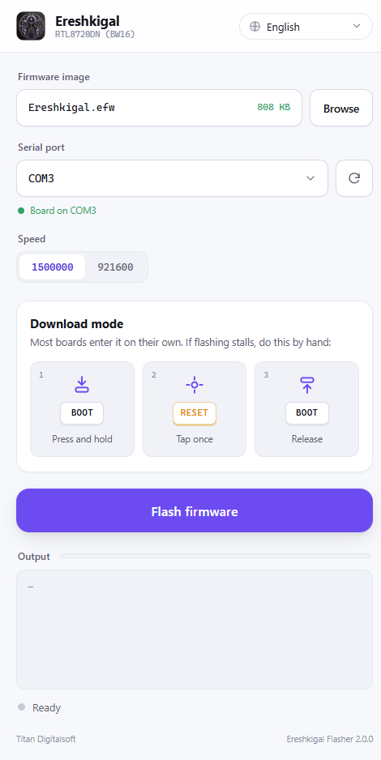
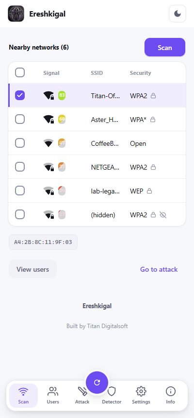

<div align="center">


# Ereshkigal Project

**一键烧录 Ereshkigal Wi-Fi 安全测试固件 RTL8720DN (BW16)。**

无需 Arduino IDE。无需源码。无需命令行。只要这个文件夹。

[English](README.md) · [Bahasa Indonesia](README.id.md) · [Español](README.es.md) · [Français](README.fr.md) · [Deutsch](README.de.md) · **中文**


-14161d)


</div>

> [!WARNING]
> **法律与安全须知 使用前请阅读。**
> Ereshkigal 是 Wi-Fi **安全测试**工具。**仅可**用于：
> - **你本人拥有**的网络和设备，或你已获得**明确书面授权**测试的目标；
> - 你为实验专门搭建的**受控实验室 / 测试环境**中。
>
> **请勿**对未获授权的网络、设备或他人使用。未经授权拦截或干扰无线网络在**大多数
> 国家/地区都属违法**，可能导致**刑事指控**。本项目仅用于教育、研究、CTF 和获授权的
> 渗透测试。**使用后果由你自行承担。**

---

<p align="center">
  
  &nbsp;&nbsp;
  
</p>
<p align="center"><sub>左：Windows 上的烧录器。右：烧录后设备内置的网页控制台。</sub></p>

## 文件夹内容

| 文件 | 说明 |
|------|------|
| **`EreshkigalFlasher.exe`** | 烧录程序（Windows，独立运行）。 |
| **`Ereshkigal.efw`** | 固件，采用 Ereshkigal 的受保护格式。 |

请将两个文件一起分发。程序为小巧的原生窗口，支持
**English、Bahasa Indonesia、Español、Français、Deutsch 和 中文** —— 在右上角切换。

## 环境要求

- **Windows 10 或 11。** 使用系统内置的 **WebView2 运行时**（Windows 11 与较新的
  Windows 10 已自带；若缺失，安装一次免费的 *Microsoft Edge WebView2 Runtime*）。
- 一块 **RTL8720DN / BW16** 开发板和一根**数据** USB 线。
- 开发板的 **USB 转串口驱动**（多为 CH340 或 CP2102），以便识别为 `COM` 端口。

## 教程 —— 四步完成烧录

1. 用 USB **插入**开发板，运行 **`EreshkigalFlasher.exe`**。
2. `Ereshkigal.efw` 已自动选中。在下拉列表中选择开发板的 **COM 端口**（若没有，点刷新
   —— 拔插开发板后再刷新，新出现的那一项就是你的板子）。
3. **速率**保持 `1500000`。
4. 点击**烧录固件**，等待**完成**，然后给开发板重新上电。

多数开发板会自动进入烧录模式。**若日志卡住**，在开发板上执行屏幕上的**下载模式**按键
顺序：

```
   ┌── 1 ──┐      ┌── 2 ──┐      ┌── 3 ──┐
   │ BOOT  │  →   │ RESET │  →   │ BOOT  │
   │ 按住  │      │ 点按  │      │ 松开  │
   └───────┘      └───────┘      └───────┘
   按住 BOOT · 点按 RESET · 松开 BOOT
```

烧录器会自动重试同步（最多 3 次）。

## 烧录后首次启动

1. 设备会广播名为 **`Ereshkigal`** 的**开放** Wi-Fi。
2. 连接后打开 **http://192.168.1.1/**。
3. 完成一次性**设置向导** —— 设定网络名称和密码（8–63 个字符）。设备保存后会重启。
4. 用你设定的密码重新连接，再次打开 **http://192.168.1.1/**，即可解锁完整控制台。

## 用它做 WPA2 → WPA3 安全检查

Ereshkigal 展示了一个真实且常见的 Wi-Fi 弱点：使用 **WPA2 但未启用受保护管理帧
（PMF / 802.11w）** 的网络，可被伪造的**去认证（deauth）**帧干扰 —— 附近任何人都能把
客户端踢下线，而这种强制断开正是抓取握手包和 evil-twin（钓鱼热点）攻击的第一步。

在你**自有**网络上的典型**授权**评估：

1. **Scan** —— 打开控制台，点 *Scan*，选择目标网络。
2. **Users** —— 列出当前连接的设备。
3. **Attack** —— 运行 *deauth* 测试，观察你自己的客户端。
4. **Detector** —— 让射频专门侦测空中的 deauth 帧。

**解读结果**
- 客户端**掉线** → 该网络是未强制 PMF 的 WPA/WPA2，易受管理帧伪造攻击（deauth 拒绝
  服务，以及随后的“先断开再抓包”链条）。
- 客户端**保持连接** → 管理帧已受保护。

**解决办法 —— 升级到 WPA3。** 将网络切换到 **WPA3（SAE）**，或至少 **WPA2 且把 PMF 设为
_必需_**（802.11w）。WPA3 强制保护管理帧，伪造的 deauth/解除关联会被忽略。**之后重跑
同一个 deauth 测试** —— 客户端应保持连接，证明升级已堵住漏洞。这个前后对比正是重点：
用 Ereshkigal 来论证并验证 WPA2 → WPA3 的迁移。

> 仅可对你拥有或获授权测试的网络使用，且在你的受控实验环境中进行。

## 故障排查

| 现象 | 解决方法 |
|------|----------|
| **没有 COM 端口** | 安装 USB 转串口驱动；使用数据线（而非仅充电线）。 |
| **“Failed to open COM…”** | 端口被其他程序占用（串口监视器、其他烧录器）。关闭它。 |
| **反复重试后失败** | 重试期间执行下载模式顺序：按住 BOOT、点按 RESET、松开 BOOT。 |
| **仍然失败** | 将**速率**降到 `921600` 再烧录。 |

## 关于固件格式

`Ereshkigal.efw` 是 Ereshkigal 自有打包格式的固件。烧录器会在内部为开发板准备它 ——
你无需解包，也不需要额外工具。请将 `.exe` 与 `.efw` 放在一起。

---

<div align="center">
<sub>Ereshkigal 由 <b>Titan Digitalsoft</b> 出品 · Flasher 2.0.0 · 仅限授权测试</sub>
</div>
